## operaciones basicas con opene CV
## Alumno Christian Garcia Jimenez Nc = 0068
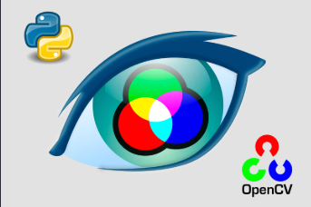
# 1. LECTURA DE LA IMAGEN DESDE LA CARPETA
#### Cuando no puede cargar la imagen 
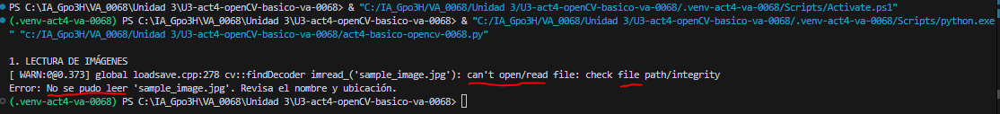
#### Cuando puede leer mi imagen 
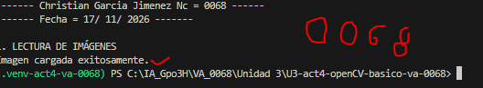
## 2. PROPIEDADES DE LA IMAGEN
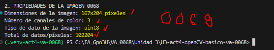
## Mostrando imagen original
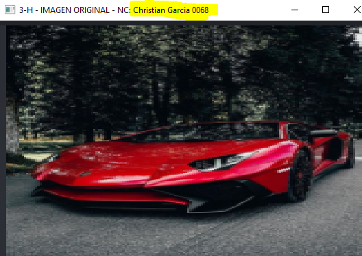
## en la terminal 
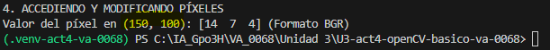
## 4. ACCESO Y MODIFICACIÓN DE PÍXELES INDIVIDUALES
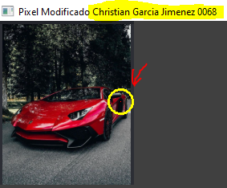
## En la terminal
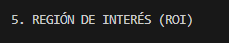
## 5. REGIÓN DE INTERÉS (ROI - REGION OF INTEREST)
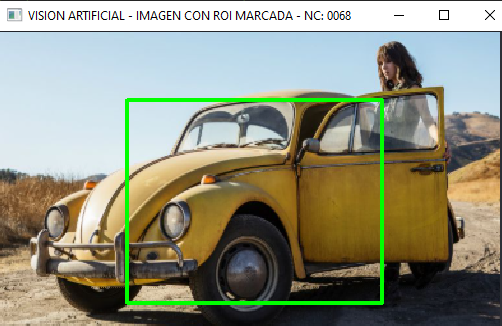
## En la terminal
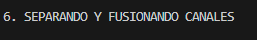
## 6. SEPARACIÓN Y FUSIÓN DE CANALES DE COLOR (BGR)
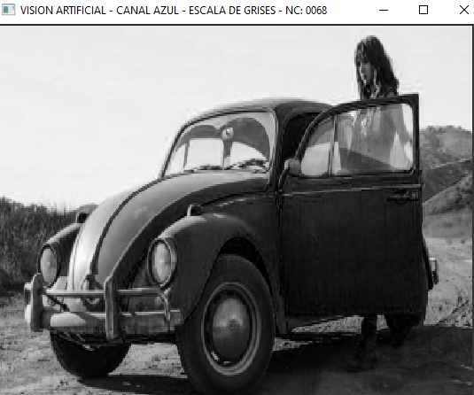
## En la terminal
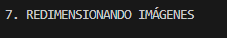
## 7. REDIMENSIONAMIENTO DE IMÁGENES (RESIZING)
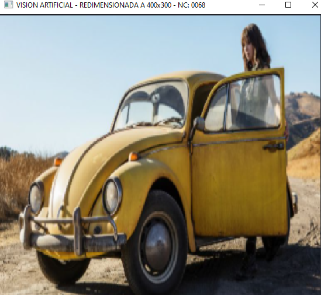
## En la terminal
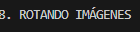
## 8. ROTACIÓN DE IMÁGENES
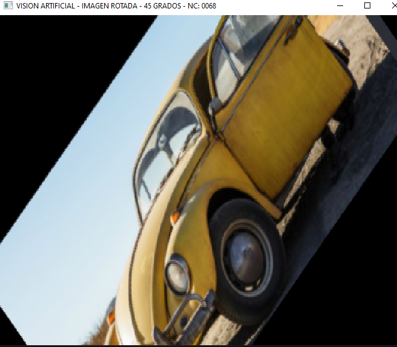
## En la terminal
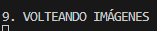
## 9. VOLTEO / ESPEJO DE IMÁGENES (FLIPPING)
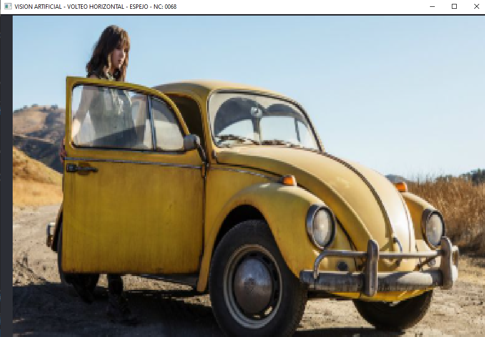
## En la terminal 
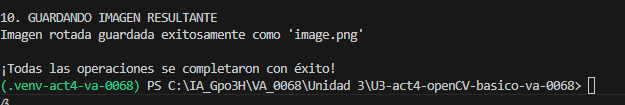
## 10. GUARDADO DE RESULTADOS Y LIMPIEZA
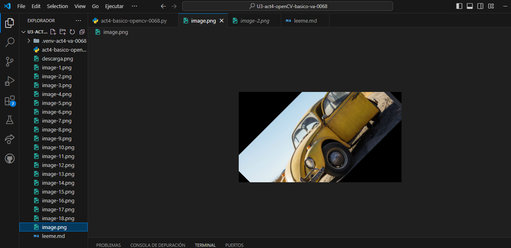